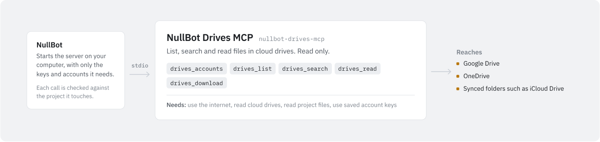

# NullBot Drives MCP

<picture>
  <source media="(prefers-color-scheme: dark)" srcset="assets/nullbot-drives-mcp-dark.svg">
  
</picture>

`nullbot-drives-mcp` gives read-only access to Google Drive, OneDrive and local synced folders such as iCloud Drive: it lists folders, searches names, reads text and returns bounded file bytes. It is a standalone Go MCP server built on `github.com/Bradthebrad/tinychain/mcp`; it works with NullBot and with any other MCP client, and it runs over stdio only. Starting the server, listing its tools and calling `drives_accounts` never contact a provider.

## Tools

| Tool | Arguments | What it does |
| --- | --- | --- |
| `drives_accounts` | none | Lists each account's `id`, `service`, `label`, `mode` (`cloud_token` or `local_synced_folder`) and `read_only: true`. Never includes credentials or the configured local root. |
| `drives_list` | `account_id`; optional `item_id` (default `root`) and `limit` (1–100, default 50) | Lists the immediate children of a folder. |
| `drives_search` | `account_id`, `query`; optional `item_id` and `limit` | Searches names. Local accounts walk the folder tree from `item_id`; Google Drive searches file names across the account; OneDrive uses the provider's search across the account. |
| `drives_read` | `account_id`, `item_id`; optional `max_bytes` (1–262,144, default 65,536) | Returns the start of a file as UTF-8 text. Binary content and text with control characters other than tab, CR and LF are rejected. |
| `drives_download` | `account_id`, `item_id`; optional `max_bytes` (same limits) | Returns the start of a file as base64 inside the result. It never writes a file. |

Results are JSON text. Errors are short, sanitized messages returned with MCP `isError: true`.

- Content results from `drives_read` and `drives_download` contain `encoding` (`utf-8` or `base64`), `data`, `bytes` (raw bytes returned), `truncated` and `read_only`. Check `truncated` before treating a download as a complete file. When the byte cap splits a UTF-8 character, `drives_read` drops that incomplete character.
- Listings contain `items` (each with `id`, `name`, `folder`, and `size` and `mime_type` when known), `has_more`, `scope` and, for local accounts, `skipped` (entries that could not be opened safely). Ordering is not specified.
- Cloud results are the first provider page only; no continuation token is exposed. Google Drive listings and searches skip trashed files.
- Local listing and search scan at most 2,000 entries and never follow links. Local `has_more` is conservative: reaching the result limit sets it even if that was the last entry.
- `query` is 1–200 bytes. Cloud search needs `item_id` to be `root` (it is account-wide), and cloud queries cannot contain `/`, `\` or control characters.
- Unknown arguments are rejected; every tool schema sets `additionalProperties: false`.

## Use it with NullBot

NullBot is a small, auditable Go agent ([Bradthebrad/nullbot](https://github.com/Bradthebrad/nullbot): terminal UI and headless CLI). Its main interface is the desktop app ([Bradthebrad/nullbot_ui](https://github.com/Bradthebrad/nullbot_ui)).

This server has no GitHub release yet, so the desktop app's Tools > Marketplace lists NullBot Drives MCP as "Not released yet" and cannot install it. Once a release with a Windows `.exe` and `SHA256SUMS.txt` is published, "Check for updates" in Tools > Marketplace makes it installable. NullBot refuses to install this server from a release that has no SHA-256 checksum for the file.

After a release exists:

1. Install it from Tools > Marketplace. NullBot downloads the `.exe` into `~/.nullbot/mcp/nullbot-drives-mcp/`, checks it against `SHA256SUMS.txt` and records the hash. Turn the server on (or tick "Turn on after installing").
2. Add accounts in Settings > Accounts, under Service accounts: Google Drive, OneDrive or iCloud Drive (local). Saving does not contact the provider or check the credentials, so the status reads "Configured locally — unverified". "Allow write/send operations" has no effect for this server; it has no write tools.
3. Restart active runs after you add, replace or delete an account.

How accounts reach the server:

- NullBot stores service account secrets with current-user Windows DPAPI under `%LOCALAPPDATA%\NullBot\ServiceAccounts\`, outside `~/.nullbot`. Service accounts work only on Windows; on other systems the store is unavailable.
- When it starts this server, NullBot puts only the drive accounts (`google_drive`, `onedrive`, `icloud_drive`) into the server's environment as `NULLBOT_SERVICE_ACCOUNTS`. Email and message accounts go only to their own servers.
- It does this only for the server installed from the Marketplace. The server must be turned on, run over stdio with no arguments other than `--transport stdio`, live in `~/.nullbot/mcp/nullbot-drives-mcp/`, come from `Bradthebrad/nullbot-drives-mcp`, and still match the SHA-256 recorded at install. NullBot hashes the file again each time it starts the server.
- A binary you build and add by hand does not receive account secrets. NullBot sets `NULLBOT_SERVICE_ACCOUNTS` to empty for it and ignores that key, and other service keys such as `GOOGLE_DRIVE_*` and `ONEDRIVE_*`, in a server's own environment settings. For every server it starts, NullBot also blanks inherited environment variables whose names look like credentials (containing `TOKEN`, `SECRET` or `PASSWORD`, or ending in `_API_KEY`, `_AUTH` or `_CREDENTIALS`).

NullBot also checks every tool call against the permission of the project it touches (Read only, Read & write, Full, Custom). These tools take no file paths, so the check uses your primary project. NullBot infers what a tool needs from its name: `drives_accounts`, `drives_list`, `drives_search` and `drives_read` need read access, but `drives_download` counts as a write because its name contains "download", so a Read only project blocks it. If you want downloads in a Read only project, set `drives_download` to "Read" in Tools > Tool servers.

## Accounts

The only configuration input is the environment variable `NULLBOT_SERVICE_ACCOUNTS`, a JSON array. NullBot fills it in; with another client you set it yourself. A missing or empty value, or `[]`, means no accounts. The server reads no credential files.

Each entry has these keys, matching NullBot's service account format:

| Key | Meaning |
| --- | --- |
| `id` | The ID tools use as `account_id`: 1–64 ASCII letters, digits, `_` or `-`, unique. |
| `service` | `google_drive`, `onedrive` or `icloud_drive`. Entries for other services are ignored. |
| `label` | Display name: not blank, up to 120 bytes, no CR, LF or NUL. |
| `fields` | Exactly one of `access_token` or `root` (below). |
| `allow_write` | Accepted for compatibility. It never enables writes. |

At most 100 accounts and 1 MiB of JSON are accepted. If the value is invalid, or a local root cannot be opened safely, the server prints an error to stderr and exits with status 2; it does not echo the input.

| Service | Fields | Notes |
| --- | --- | --- |
| `google_drive` | `access_token` | Your own OAuth access token with read access, typically `drive.readonly`. |
| `onedrive` | `access_token` | A delegated Microsoft Graph token, typically `Files.Read`. Requests use `/me/drive`, so application-only tokens do not work. |
| `icloud_drive` | `root` | The absolute path of a local synced folder. There is no Apple sign-in, password, token or cloud API. |

- Tokens are up to 16,384 bytes with no control characters. There is no token refresh: when a token expires, supply a new one and restart the server.
- With another client you may set `root` instead of `access_token` for any of the three services, to read a local synced copy. NullBot's settings offer only an access token for Google Drive and OneDrive, and only a root for iCloud Drive.
- `root` must be an absolute path to a readable directory. Windows UNC and device paths (starting with `\\`) are rejected; on Windows the root must be on a drive letter. Local mode works on Windows and Linux; on other systems local accounts fail at startup.
- Local item IDs are `/`-separated paths relative to the root. An empty ID, `root` and `.` all mean the root itself, so a top-level entry named `root` cannot be addressed. Cloud item IDs are the provider's IDs: up to 256 letters, digits, `_`, `-` and `!`.

Example with fake placeholder values:

```json
[
  {"id": "work-drive", "service": "google_drive", "label": "Work Drive", "fields": {"access_token": "PLACEHOLDER"}, "allow_write": false},
  {"id": "onedrive", "service": "onedrive", "label": "OneDrive", "fields": {"access_token": "PLACEHOLDER"}, "allow_write": false},
  {"id": "local-icloud", "service": "icloud_drive", "label": "Local iCloud files", "fields": {"root": "C:\\path\\to\\iCloudDrive"}, "allow_write": false}
]
```

Do not put real credentials in source, commands, logs or committed MCP client configuration.

## Use it with another MCP client

Build the binary (see [Build and test](#build-and-test)) and point your client at it:

```json
{
  "mcpServers": {
    "drives": {
      "command": "C:\\path\\to\\nullbot-drives-mcp.exe",
      "args": ["--transport", "stdio"],
      "env": {"NULLBOT_SERVICE_ACCOUNTS": "[]"}
    }
  }
}
```

Supply the real account JSON through your client's secret or environment settings, not a committed file. The server writes nothing to stdout except MCP protocol messages (or the `--version` line).

| Flag | Default | Meaning |
| --- | --- | --- |
| `--transport` | `stdio` | Only `stdio` is accepted. Any other value, including `http`, `streamable-http` and `sse`, exits with status 2, so account tools are never exposed on an unauthenticated listener. |
| `--version` | | Print the version (`0.1.0`) and exit. |

## Safety

- There are no write tools, whatever `allow_write` says. Nothing is uploaded, moved, deleted, shared or synced.
- Cloud requests are GET only, to fixed HTTPS origins: `www.googleapis.com` for Google Drive and `graph.microsoft.com` for OneDrive. Environment proxies are not used, redirects are not followed, and each request has a 20-second timeout. Metadata responses are capped at 1 MiB and content reads at `max_bytes`. Provider response bodies and transport errors are not echoed.
- Local opening rejects `..` and other traversal, `:` (so no alternate data streams), reserved Windows device names, symlinks, junctions, other reparse points and anything that is not a regular file or folder. On Windows each ancestor folder is held open against rename and delete while the next one is opened. On Linux the path is walked from `/` with directory handles and `O_NOFOLLOW`. Cloud placeholder files are rejected even if the sync client could download them; only ordinary files already on disk can be read.
- Ancestors of the root are checked too: if any folder above the root is a symlink (Linux) or a reparse point (Windows), the account fails at startup.
- A root grants read access to every ordinary file beneath it. It is not a content filter or an OS sandbox. Choose a dedicated folder without sensitive files. Hard links and mount points are not treated as boundaries, so do not let untrusted people put files in the root. OS permission errors are reported generically.
- `drives_accounts` never shows the root or credentials. If a result, file content or download bytes contain a configured `access_token` (or a `refresh_token` or `client_secret` field, if present) verbatim, the server refuses to return it. This does not catch partial or transformed secrets, and a very short token can cause false refusals.
- Results are capped at 2 MiB of JSON.
- Labels, file names and file content are untrusted data. They may contain sensitive information or instructions; treat them as data.

## Build and test

Requires Go 1.26.4 and `github.com/Bradthebrad/tinychain v0.2.0`.

```sh
go vet ./...
go test ./...
go build -trimpath -o dist/nullbot-drives-mcp ./cmd/nullbot-drives-mcp
./dist/nullbot-drives-mcp --version
```

Windows build:

```
go build -trimpath -o dist\nullbot-drives-mcp.exe .\cmd\nullbot-drives-mcp
```

On 2026-10-27, `go vet ./...` and `go test ./...` passed with Go 1.26.4 on Linux. The tests use temporary local folders, made-up account values and an in-memory HTTP `RoundTripper`; they open no listeners and make no provider calls. They cover configuration and NullBot field compatibility, strict argument checks, local listing, search, read and download, traversal and device-name rejection, content caps and malformed UTF-8, cancellation, symlink rejection (skipped when the OS does not allow creating symlinks), fixed provider URLs, auth headers and query escaping, sanitized failures, response limits and blocking of credentials in output. Windows junction and reparse-point tests run only on Windows and were not part of the Linux run.

`scripts/smoke.ps1` is an optional PowerShell check against a built `dist/nullbot-drives-mcp.exe`. It starts the server with `NULLBOT_SERVICE_ACCOUNTS=[]`, runs initialize, `tools/list` and `drives_accounts` over stdio, checks the five tool names and the empty account list, and checks for a clean exit. It calls no provider tools.

Not verified: live Google Drive and OneDrive behavior, token validity, and real iCloud Drive sync folders.

## Limitations

- No sign-in, OAuth flow or token refresh.
- No uploads, deletes, moves, sharing changes or sync.
- No pagination: one provider page, or at most 100 local items, per call.
- No export of Google Docs, Sheets or Slides. Ordinary downloadable files work.
- OneDrive file content usually comes back as a redirect, which this server blocks, so `drives_read` and `drives_download` generally fail for OneDrive token accounts. Listing and search still work. To read OneDrive files, use a local synced folder as `root` instead.
- No retries.
- Local reads are bounded, but a slow or stuck filesystem can still block a call.
